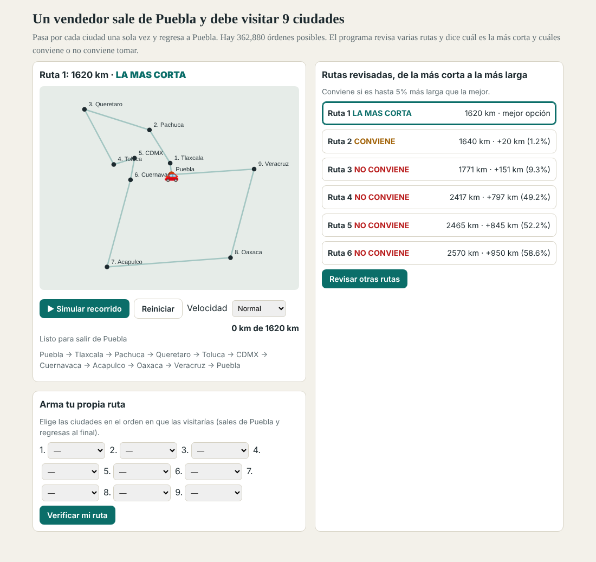
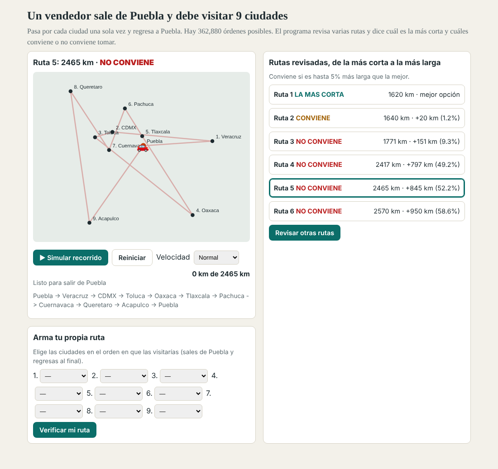
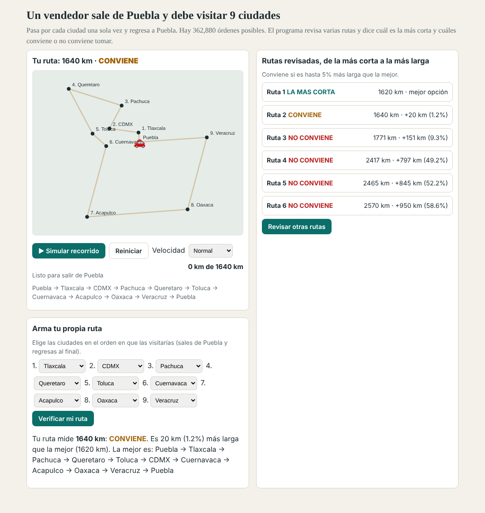
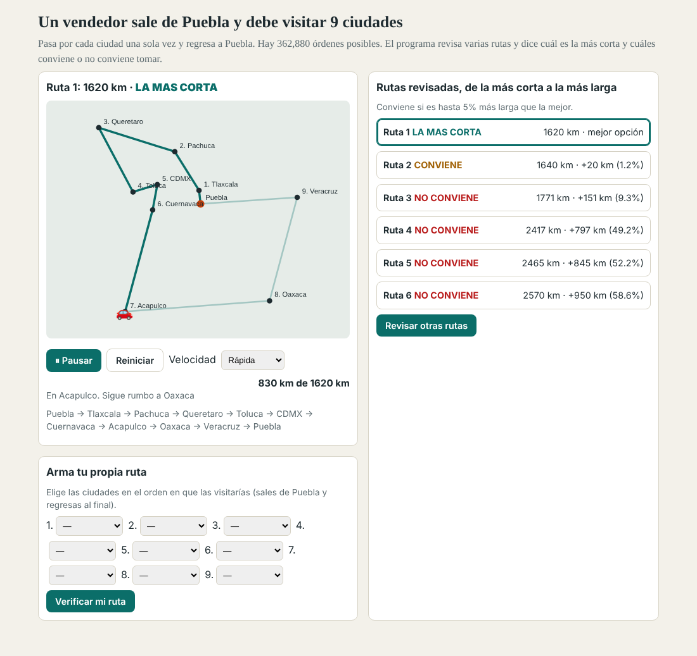

# Problema del viajante (TSP): una ruta por México con algoritmos de búsqueda

Un vendedor sale de **Puebla**, visita **9 ciudades de México** (CDMX, Cuernavaca, Toluca, Querétaro, Pachuca, Tlaxcala, Veracruz, Oaxaca y Acapulco), pasa por cada una una sola vez y **regresa a Puebla**. ¿En qué orden las visita para recorrer la menor distancia?

Con 10 ciudades existen **362,880** rutas posibles. El programa revisa varias rutas y dice cuál es **la más corta**, cuáles **convienen** y cuáles **no convienen**. También verifica la ruta que armes tú y simula el recorrido con un coche 🚗.

Proyecto escolar de Inteligencia Artificial (algoritmos de búsqueda). Autor: Nicolas Calvario Calvario, Universidad Tecnológica de Puebla.

## Algoritmos utilizados

| Familia | Algoritmo | Idea |
|---|---|---|
| Búsqueda ciega | Fuerza bruta (búsqueda exhaustiva) | Prueba las 362,880 rutas y se queda con la mejor |
| Búsqueda heurística | Vecino más cercano (voraz) | Siempre va a la ciudad no visitada más cercana |
| Búsqueda local | Hill climbing con 2-opt | Invierte tramos de la ruta si mejora |
| Búsqueda local | Recocido simulado | Acepta rutas peores con cierta probabilidad para no atorarse |
| Búsqueda evolutiva | Algoritmo genético | Población de rutas con selección, cruce OX, mutación y elitismo |

## Estructura del repositorio

```
tsp-rutas-mexico/
├── src/
│   ├── tsp_algoritmos.py   # compara los 5 algoritmos (consola, gráficas opcionales)
│   ├── tsp_rutas.py        # rutas con veredicto + verificador de ruta propia (consola)
│   └── tsp_web.py          # versión web en Python con simulación del coche
├── web/
│   └── tsp_recorrido.html  # versión autónoma en JavaScript (doble clic para abrir)
├── docs/
│   ├── Informe_TSP.docx    # informe completo
│   └── capturas/           # capturas de pantalla
├── requirements.txt
├── LICENSE
└── README.md
```

## Cómo ejecutarlo

Requiere **Python 3.8 o superior**. No hay que instalar paquetes para los programas principales.

```bash
git clone <URL-de-tu-repositorio>
cd tsp-rutas-mexico/src
```

**Versión web (se abre en el navegador):**

```bash
python tsp_web.py
```

Se abre `http://localhost:8000`. Para cerrar, presiona `Ctrl+C`. Usa `tsp_rutas.py`, que debe estar en la misma carpeta.

**Versión de consola con veredicto de rutas:**

```bash
python tsp_rutas.py
```

**Comparación de los 5 algoritmos:**

```bash
python tsp_algoritmos.py
```

Para guardar gráficas (opcional): `pip install matplotlib`.

**Versión en JavaScript:** abre `web/tsp_recorrido.html` en cualquier navegador. No necesita Python ni internet.

## Resultados

Ejecución con semilla 42 sobre el mismo caso (10 ciudades):

| Algoritmo | Distancia (km) | Vs. óptimo | Evaluaciones |
|---|---|---|---|
| Fuerza bruta | 1,620.0 | 0.0% | 362,880 |
| Vecino más cercano | 1,771.4 | +9.3% | 100 |
| Hill climbing 2-opt | 1,620.0 | 0.0% | 108 |
| Recocido simulado | 1,620.0 | 0.0% | 2,159 |
| Algoritmo genético | 1,620.0 | 0.0% | 30,000 |

Ruta más corta (1,620 km): Puebla → Tlaxcala → Pachuca → Querétaro → Toluca → CDMX → Cuernavaca → Acapulco → Oaxaca → Veracruz → Puebla.

Una ruta **conviene** si es hasta 5% más larga que la mejor (`LIMITE_CONVIENE` en `tsp_rutas.py`); si pasa de ahí, **no conviene**.

El hill climbing depende de su ruta inicial aleatoria: en algunas ejecuciones se queda atrapado en un óptimo local. Los tiempos dependen del equipo.

## Capturas

| | |
|---|---|
|  |  |
| Pantalla principal con la ruta más corta | Una ruta que no conviene (52.2% más larga) |
|  |  |
| Verificación de una ruta armada por la persona | Simulación del recorrido con el coche |

Más capturas en [`docs/capturas`](docs/capturas) y el análisis completo en [`docs/Informe_TSP.docx`](docs/Informe_TSP.docx).

## Datos y limitaciones

- Las coordenadas (latitud y longitud) de las 10 ciudades están capturadas en el código y son aproximadas, del centro de cada ciudad.
- Las distancias se calculan con la **fórmula de Haversine**, es decir, **en línea recta**, no por carretera. Sirven para comparar rutas, no como kilometraje exacto de un vehículo.
- Resultados de una sola semilla; para conclusiones más firmes sobre los métodos aleatorios conviene repetir con varias semillas.

## Licencia

MIT. Consulta el archivo [LICENSE](LICENSE).
